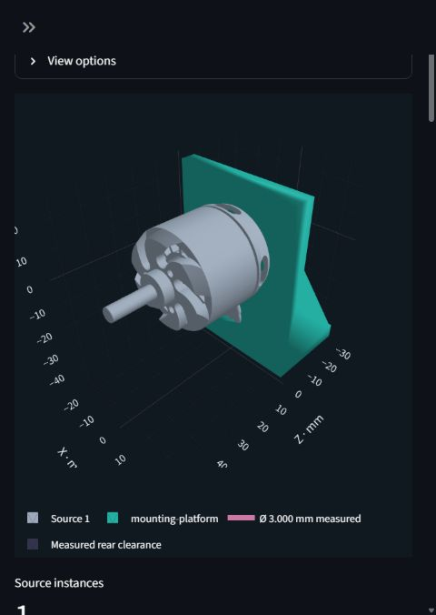

# Fixture Studio

A local conversational tool for designing fixtures around an uploaded STEP part.
OpenCASCADE measures the part; NVIDIA SMLib constructs the fixture's actual CAD.
Review mounting evidence, clarify requirements, choose a plate, rails, L-bracket or bridge,
generate geometry, revise it, and export a reproducible design record.

## Selection reliability — November 1, 2026

Mounting face and hole selection now share one persistent 3D viewer. Switching
between them preserves the camera and model instead of loading a second scene.
Hole clicks highlight immediately and save as an ordered, complete selection;
delayed updates cannot drop newer picks. Repeated clicks keep holes selected.
Use **×** in the selected-hole list or **Clear hole selection** to remove them.
Selecting a different mounting face still clears incompatible holes.

## Simplified workspace — November 1, 2026

The model preview and fixture thickness stay visible. Open **Choose mounting face
and holes** to change the mounting selection; it starts open until a mounting face
is confirmed. **Display settings** contains overlays and on-model dimension editing.
Detailed settings are grouped in **Mounting**, **Fabrication**, and **Advanced**
tabs below the thickness control. All settings remain available and retain their
saved values when switching groups. Additional proposals are under **More fixture
concepts** after the first two choices.

The sidebar groups part import, assistant settings, saved projects, revision history
and technical exports. STEP preparation remains directly accessible. Existing
projects can continue through the conversation without reopening a starting brief.

## Thickness and preview update — October 31, 2026

**Fixture thickness (mm)** is now visible below the viewer under **Fixture
dimensions**. Editing it saves the requirement immediately. For an existing
fixture, choose **Rebuild with this thickness** to regenerate CAD through the
normal checks and AI-review workflow. Until then, the previous revision stays
visible and its thickness is identified. This changes the fixture, not the
uploaded STEP. Locked thickness values remain protected.

Generation and revision restore now return to the assembly preview with the
fixture visible, even when started from a face, hole or opening picker. Use
**View generated fixture** to inspect the CAD alone, or **View assembly** to see
it with the uploaded part. Selection categories continue to show the source for
picking. Failed rebuilds retain the last valid CAD and show the error.

## Feature expansion — October 30, 2026

Features **1–6** are implemented on `feature/fixture-tools-1-6`. The rollback
baseline is commit `3a66d5c`; the feature work has not been merged into `main`.

| Feature | What is available |
| --- | --- |
| 1. Selected access | Click measured faces, holes or rear profiles for full-through openings and finite keep-clear areas. Cuts follow thickness revisions and are checked against final native geometry. |
| 2. Existing base | Upload a second STEP, select its contact face and holes, and position it using in-plane offsets/rotation. The fixture copies the measured base pattern. |
| 3. Retention | Convex-envelope contour nests, open cylindrical saddles, closed collars and split clamps with separate caps, alongside existing screw mounts and trays. |
| 4. Dimensions | Set **Fixture thickness (mm)** below the viewer, or enable **Edit dimensions on model** to edit/lock other supported values. Rebuild through the normal revision and AI-review workflow. |
| 5. Hardware | Optional part/base counterbores, 90° countersinks, hex nut pockets and finite screwdriver access. Native checks cover voids, sidewalls and seat floors. |
| 6. Manufacturing geometry | Printing chamfers exposed base corners; machining rounds them and adds cutter relief to rectangular openings. Method selection needs no material, printer or slicer settings. |

UI Man supplied the coordinated presentation refresh and hardware controls, with
existing widget callbacks and backend contracts preserved. Manufacturing corner
size defaults to `min(2 mm, thickness / 3)` and is editable on the model. This is a
concept assumption. New projects enable the rules; old projects keep their original
geometry until the manufacturing method is saved or changed.

The final complete suite passed **165 tests**, followed by **4 passing dimension/
pointer tests** for the live click-selection fix (overlapping runs). The new connector,
split-clamp and contour-nest demos generated real SMLib solids, exported STEP and
reproduced from their ZIP records. A real subscription-model revision changed the
connector's part counterbores to countersinks, preserved its base and through-opening
selections, generated CAD and received an **accepted** AI concept review.

The earlier **3 hours 30 minutes** below is the user-reported baseline. No new
cumulative duration has been supplied.

**Implemented and verified on Windows x64 / Python 3.12.10.** Both native kernels,
the Streamlit workflow, revisions, native checks, USD BRep round trips and clean
lockfile installation have been exercised. A real three-turn conversation using
the local Codex CLI's **ChatGPT subscription sign-in** generated and revised a
six-part fixture without an API key. The separate OpenAI API backend is implemented
and tested with test doubles; no API-key-backed live call has been made.

## Planner recovery follow-up — October 30, 2026

Planner follow-up: measured opening selections now round-trip through AI planning
without being mistaken for unknown features. Explicitly free-floating fixtures
use **None — free floating** under attachment to surroundings; their selected part
screws remain in place. Failed planning keeps saved choices/CAD and records the
reason in the conversation, so it can be addressed on the next Start design attempt.
The local project JSON also retains the latest validated decision and error for
debugging. It is not included in the public source or fixture export.

Face and hole picks now save immediately and remain highlighted when switching
selection categories. Picking a face does not preselect its holes. Mode changes
update the workspace without rerunning the conversation or proposals. Examples
are collapsed under **Try an example**. Verification: **184 tests passed** in the
full run, followed by **48 passing affected integration checks** after the final
UI fixes, plus real-browser selection checks.

## Baseline checkpoint — October 30, 2026

**Total project time so far: 3 hours 30 minutes (3.5 hours), reported by the user.**
This is the cumulative checkpoint total, not an additional development interval.

- Working flow: STEP upload and measurement, mouse selection of mounting faces/holes,
  conversational requirements, Start design, proposals, SMLib generation, AI feedback,
  revisions/restore and verified STEP export.
- Supported fixtures: plates, rails, ribbed L-brackets, bridges, and rectangular
  locating trays with optional external-strap slots for parts without mounting holes.
- Design controls include manufacturing method, screw-size suggestions, automatic
  standard clearances, configurable base-hole counts and real through passages.
- Verified examples include the supplied motor and IEC connector, unrelated synthetic
  parts, and hole-free tray geometry. Latest full suite: **126 passing tests**, plus
  **8 passing workflow tests** after the final prompt adjustment; Ruff F checks passed.
- Public source is available on [GitHub](https://github.com/lrosu02/fixture-studio).
  Credentials, private uploads and local projects are excluded.

Remaining: the continuous demo recording, a live API-key-backed test, and broader
geometry/engineering capabilities. Contact remains sampled; operating strength and
exact source-to-fixture BRep collision are not validated. The suggested next feature
was selecting openings and keep-clear areas directly in 3D; that is now implemented
in the feature expansion above.
See the [plan checkpoint](IMPLEMENTATION_PLAN.md#implementation-checkpoint--october-30-2026)
and [engineering record](Notes.md#checkpoint-and-total-time--october-30-2026).

## Supported inputs and behavior

- One STEP imported automatically as one complete part (up to 16 source solids), with
  analytic planar mounting/support faces or complete outside cylindrical support
  faces. Circular mounting holes are optional.
- STEP units normalized to millimeters, relative body placements preserved,
  source preview cached, stable measured feature IDs and candidate selection.
- Coaxial inward cylindrical faces grouped to measure bores; selectable hole
  subsets let you exclude ports. Modeled diameter is separate from thread size.
- Mouse picking of detected hole rims/centers in the 3D STEP preview, including
  ambiguous faces. Confirmed picks become the measured mounting pattern.
- Matching **Select mounting face** and **Select mounting holes** buttons. Click
  a measured planar surface to highlight it and show the fixture-side arrow,
  review its detected holes, then apply. Rotating or repeating a click does not
  deselect it. A face list is also available.
- Hole-free faces support measured rectangular locating trays, optionally with
  through slots for an external retaining strap. Retention is an explicit choice;
  the app does not invent part holes or assume that a resting tray holds a part down.
- One to 24 source instances in rows or grids; user-controlled gap, thickness,
  margin, maximum width and requirement locks. Clearance holes default to ISO 273
  medium per fastener size, with optional explicit overrides.
- Common plates, open parallel rails, ribbed L-brackets and bridge supports;
  clamp lands or base bolt holes, including perpendicular holes in L-bracket feet.
- Adjustable mounting height, L-bracket base depth and optional triangular ribs.
  Dimensions follow measured bounds; no motor pattern or quantity is hardcoded.
- Configurable total base-hole count, separate from the part's mounting pattern.
  Any positive integer is accepted, subject to geometric fit and the bounded CAD
  operation budget. An unspecified L-bracket base grows deeper when needed.
- Finite box access regions that cut real stock. Plates, L-brackets and bridges relieve
  separate rear protrusions with measured cylindrical or convex-profile cuts,
  while preserving the selected mounting contacts.
- Conversation, relevant clarifications, proposal comparison, evidence highlighting,
  native CAD generation, per-check results, revision comparison, restore and export.
- Start design prepares an AI proposal from the brief and saved part context.
  Generation automatically requests AI feedback, with at most one bounded correction.
- Manufacturing method carried into the conversation, proposal guidance, saved
  revisions and exports. No material, machine or slicer setup is requested.
- Saved project snapshots can be resumed from the sidebar. All source solids are
  kept together in their original relative placement; no manual body selection.

This is a geometric concept tool. Contact is sampled, exact cross-kernel source
collision is not evaluated, and operating performance is not certified.

## Setup

Clone the public [Fixture Studio repository](https://github.com/lrosu02/fixture-studio),
or use the supplied project folder/submission archive. Install 64-bit CPython **3.12** and the
[Microsoft Visual C++ Redistributable](https://learn.microsoft.com/cpp/windows/latest-supported-vc-redist).
The NVIDIA wheel includes its SMLib and OpenUSD native libraries; no source build
or OCCT-to-USD converter is required. Do not install another OpenUSD/`pxr` runtime
into this environment.

From PowerShell (skip the first two commands if already in the project folder):

```powershell
git clone https://github.com/lrosu02/fixture-studio.git
Set-Location fixture-studio
python --version
python -m venv .venv
.\.venv\Scripts\python.exe -m pip install -r requirements.lock
.\.venv\Scripts\python.exe -m pip check
.\.venv\Scripts\python.exe scripts\prove_dependencies.py
.\.venv\Scripts\python.exe -m streamlit run app.py
```

Open [Fixture Studio](http://127.0.0.1:8501). The server binds to loopback by
default. These commands were also exercised in a fresh `.venv-clean` environment.
The `py` launcher on the development machine does not discover Python, so the
instructions deliberately use `python`.

## Conversation provider

**ChatGPT subscription (Codex CLI)** is the preferred backend when `codex` is on
PATH. It uses supported CLI authentication and structured output, not desktop UI
automation or extracted credentials. It consumes your subscription allowance and
is subject to that plan's limits. The installed CLI tested here is
`0.165.0-alpha.1.2`.

```powershell
codex --version
codex login status
# If needed, run codex login and complete ChatGPT sign-in yourself.
.\.venv\Scripts\python.exe scripts\prove_subscription.py --full
```

If discovery fails, set `FIXTURE_CODEX_PATH` to your installed `codex.exe`.
`FIXTURE_CODEX_MODEL` optionally selects an available model; otherwise the CLI
uses its default. Each request uses a fresh ephemeral read-only process with
execution, apps, plugins, browser/computer control and multi-agent tools disabled.
API-key login is rejected by this backend. No global Codex config is changed.
See [authentication](https://learn.chatgpt.com/docs/auth) and
[non-interactive mode](https://learn.chatgpt.com/docs/non-interactive-mode).

**OpenAI API** is an optional independent backend. Set `OPENAI_API_KEY` in the
launching environment and optionally `OPENAI_MODEL` (default `gpt-6-astra`), then
select OpenAI API in the sidebar. This backend uses the Responses API, is
separately metered and has no automatic fallback from subscription mode.
Do not put credentials in source files. `.env` files are ignored by version
control but are **not automatically loaded**.

**Offline commands** uses a visibly labeled limited parser, with no model calls.
Examples: `quantity 6 grid 3 columns`, `gap 20`, `more rear access with rails`,
`plate`, `width 100`. Use the requirements form for other facts. Arbitrary prose
is not fully interpreted in this mode.

All live backends send the measured feature summary, requirements and recent
conversation to OpenAI. CAD review also sends rendered assembly/fixture views.
Original STEP bytes and mesh arrays are not sent.

## Start a design and receive AI feedback

1. Upload a part, choose the manufacturing method and select mounting holes
   when necessary. Choose **ChatGPT subscription (Codex CLI)** or **OpenAI API**.
   For a flange or ambiguous mounting side, use **Select mounting face**, click the
   contacting surface and review the orange fixture-side arrow. Choices save on
   selection, without another confirmation. Selecting a face does not select its
   holes; use **Select mounting holes** for those. Changing the face clears incompatible
   hole, passage and access-box choices; locked requirements remain protected.
2. Enter the task in **Design brief** and click **Start design**. Leave the brief
   blank to continue the saved conversation. The AI extracts stated facts and asks
   up to three relevant questions at a time. Answer in the chat box.
3. Review the mounting proposals and displayed concept dimensions. Accept their
   assumptions when appropriate, then choose **Generate** for the chosen structure.
   Start design itself prepares a proposal; it does not bypass this review step.
4. The app generates real CAD, runs geometric checks and sends the attempted plan,
   measured results and three rendered views to the AI. Its feedback appears below
   the viewer and in the conversation. A failed attempt is reported as a failure,
   not confused with the previous valid assembly.
5. The AI may make **one** correction to an unlocked, default/AI-assumed gap,
   margin or thickness, then rebuild and review once more. User-specified dimensions,
   measured mounting features, clearances and other requirements cannot change in
   this automatic step. Further changes require your feedback in chat.
6. To change stock thickness directly, edit **Fixture thickness (mm)** below the
   viewer and choose **Rebuild with this thickness**. Use **View generated fixture**
   for a fixture-only preview; use revision history to restore an earlier result.

**Advanced — requirements and assumptions** is collapsed by default. Use it for
manual overrides and locks; normal clarification happens in the conversation.
Page refreshes do not trigger model calls or builds. Offline commands keeps its
manual generation workflow with geometric checks and no AI review. Review errors
or timeouts preserve generated CAD and are visibly marked incomplete.

CAD saves use private staging files, native reopen checks and atomic publication.
Transient save failures are retried at most three times with the same geometry.
An incomplete or mismatching export cannot become a valid revision. Persistent
file-save errors preserve prior CAD and ask you to retry Generate; they do not
trigger AI changes to dimensions or consume an AI review call.

The product is intended for different fixture tasks and part types. Current CAD
composition support includes plates, parallel rails, L-brackets and bridges around
recognized planar/circular interfaces, plus locating trays, convex contour nests
and measured cylindrical retention. Freeform conformal nests, articulated clamps and
arbitrary angled structures still require compiler extensions; the motor example does not define the product.
AI feedback is a concept review, not structural or manufacturing certification.

To reproduce a real two-part sensor fixture and visual AI review using the existing
ChatGPT sign-in (uses subscription allowance):

```powershell
.\.venv\Scripts\python.exe scripts\prove_feedback.py
```

The recorded run is in [live-feedback-record.json](demo/live-feedback-record.json),
and its CAD, checks, feedback and views are in [live-feedback-export.zip](demo/live-feedback-export.zip).

## Reproduce the example

1. Expand **Try an example** in the sidebar and load `synthetic_motor.step`.
   It is original synthetic geometry, **not the
   user's actual brushless motor**. The tool identifies a candidate outer mounting
   face; inspect its four measured 4 mm bores and 34 x 22 mm pattern.
2. In subscription mode, enter in **Design brief**: “I want a fixture for six of
   these parts so they can run continuously. Keep it accessible and give it a clean
   appearance.” Click **Start design**, then answer in chat.
3. For this synthetic example only, select the stationary face and its four
   holes; specify **3.5 mm fixture clearance**, **six instances**, **grid / three
   columns**, **clamps**, and **machined solid stock concept**. Set operating
   loads, nominal thread and engagement to **unknown**. State that rear
   tool access is desired and that finite tool dimensions are unknown. Accept
   the visible concept defaults (6 mm stock, 8 mm margin, 12 mm gap).
4. Review the common plate and open-support proposals. Generate the plate.
   Expect six source meshes on one teal SMLib body with 24 actual mounting holes.
5. Request: “Revise it to open parallel supports for more rear tool access and
   less material. Preserve all measured holes, six instances and the three-column
   grid. Generate the revision.” Expect four separate rails and the same 24 holes.
6. Toggle source/fixture/evidence/access, compare the previous revision, inspect
   checks, and restore a revision if desired. Download **Export CAD + design record**.

For a fully reproducible no-model run:

```powershell
.\.venv\Scripts\python.exe scripts\demo.py
.\.venv\Scripts\python.exe scripts\reproduce.py demo\example-export.zip artifacts\reproduced
```

The demo plate volume is approximately **109,014.516 mm³**; the revised supports
total **38,358.615 mm³**. The latter was rebuilt from the export in a clean
environment. [Interactive assembly](demo/assembly.html) shows the actual
tessellated BReps with a transparent previous-revision overlay.
[Live subscription record](demo/live-subscription-record.json) contains the real
planner outputs; [live export](demo/live-subscription-export.zip) contains CAD.
The [demo guide](demo/DEMO.md) gives a 2–3 minute walkthrough.

For an unrelated example, load `sensor_bracket.step`: three 5 mm holes with an
unequal pattern. Use a confirmed 4.5 mm fixture clearance for that synthetic
specimen. Geometry follows its measured interface, not the motor example.

To add a real opening, enter this in **Advanced — requirements and assumptions → Clearance volumes (optional) → Clearance boxes (advanced JSON)**:

```json
[{"id":"rear-tool","minimum":[-4,-4,-8],"maximum":[4,4,1],"purpose":"Finite rear tool access","provenance":"user"}]
```

It creates an 8 x 8 mm through opening in 6 mm stock if contact patches permit.
The check concerns fixture obstruction; source-part obstruction remains unevaluated.

## Parts without mounting holes

Load `hole_free_housing.step`, press **Select mounting face**, and select its flat
bottom surface. The surface choice saves immediately. No hole selection is required.

Under **Part retention**, choose **Locating tray — no hold-down** or
**Locating tray with an external strap**, then **Apply part retention**.
Walls follow the whole part's measured rectangular envelope, with editable defaults
of 0.5 mm fit clearance and 3 mm wall thickness. Wall height defaults to the smaller
of 5 mm and half the part height. These are concept dimensions, not load sizing.
Strap mode requires its width and thickness and adds two full-depth slots with
1 mm fit allowance. The strap itself is separate hardware and needs underside
threading access. The conversation should confirm that crossing over the part is suitable.

For the bundled housing, try: “Make a 3D-printed locating tray for one housing,
resting upright during bench inspection. Leave the top open. Attach the tray to
the bench with four M3 screws. No moving loads. Accept the displayed concept defaults.”
Click **Start design**, review the proposal, and generate. Request a revision to
increase part-to-wall clearance to 1 mm, then **Prepare STEP download**.
The fixture has locating walls and base holes, with no invented part screw holes.

The support face must be an outer plane with the whole part on its inward side.
Rectangular trays do not follow arbitrary contours; use the convex contour nest
or measured cylindrical retention described below where appropriate. Checks cover sampled face support, measured-envelope clearance,
wall material and unobstructed strap slots. Holding force is not evaluated.
Older saved analyses retain their original candidates; re-upload the original STEP
to expose additional hole-free faces. Existing saved revisions remain available.

## L-brackets and bridge supports

Choose **L-bracket** or **Bridge support** in a conversational request or the
advanced Structure selector. Mounting coordinates always come from the selected
STEP interface; part count/layout remain user choices and clearances resolve automatically.
The four families are in `fixture/structures.py`; every fixture primitive, sweep,
union and cut executes in SMLib. CadQuery/OpenCASCADE measure the source and serialize
the generated SMLib boundary representation to STEP; fixture operations are never replayed there.

- **L-bracket:** a mounting wall, perpendicular rear foot and optional triangular
  side ribs become one solid. `mount_height` is the measured interface origin above
  the base top along +Y. `base_depth` is the foot extent behind the interface along
  -Z. The USD stage and previews use Y-up. Base bores run along Y; part bores remain
  along Z. No arbitrary-angle inference is made.
- **Bridge:** a mounting platform joins two side legs and outboard feet. Height is
  the interface plane above the base top along +Z. Feet are included in the maximum
  width constraint. The open region beneath the platform provides rear access.
- Unset dimensions are derived from measured bounds, thickness and margin, displayed
  on proposals, and require acceptance as concept defaults. They do not establish
  propeller clearance or load capacity. Describe propeller position, axis and desired
  clearance in the conversation; nominal screw size does not establish stand height.
- Rear protrusions are separated into connected patches of the clipped source
  mesh. Each receives an enclosing cylinder or convex-profile swept cut, instead
  of one box spanning every protrusion. All cuts are real SMLib geometry; mounting
  holes and support regions remain protected. A genuine overlap still blocks
  generation and explains when another interface or a stand-off design is needed.
- **Rear protrusion clearance (mm)** in Advanced controls padding from 0.3 to
  10 mm, with requirement locks and revisions. The 0.3 mm minimum accounts for
  twice the source mesh chord tolerance. **Display settings → Access volumes** shows
  these envelopes in purple. This is a conservative mesh approximation, not an
  exact source/fixture collision bridge. Wire routing, tools and future moving
  parts still need their own dimensions; existing STEP relief does not infer them.
- Enhanced clearances are bounded to 32 patches per source and 48 vertices per
  convex profile, with the overall operation limit still enforced. Exported
  version-2 plans reproduce these cuts; historical version-1 plans retain their
  original compiler behavior.
- New version-3 plans permit clearance larger than a modeled thread/bore only while
  retaining at least 1 mm to the sampled outer contact radius. Automatic sizes follow
  the policy below; thread identity and engagement are not established by a measured opening.

### Through passages and proposal variants

Measured rear reliefs clear protrusions only to their measured depth; they can be
blind pockets. To route wires through an existing recess, ask **“Make the lower
rear recess a through passage and generate a revision.”** The conversation can
select a measured profile by its supplied location without inventing coordinates.
Alternatively, open **Fabrication → Wire and tool passages**, choose the
recess, **Apply through passages**, then Generate. Only selected profiles extend
through the entire fixture in the mounting-normal direction. Their measured
outlines stay unchanged; unselected shaft/other reliefs keep their original depth.
Native checks test the complete passage for remaining fixture material, including
after a thickness change. Cable bend radius and connector fit remain separate.

Mounting proposals now include an open/ribbed L-bracket alternative and raised
L-bracket/bridge variants when allowed by the saved constraints. Raised variants
add twice the current stock thickness to the derived mounting height; they are
offered only when height is unset and unlocked. These are distinct constructions
within the four supported families. Locks, selected holes, passages and clearances
are preserved, and infeasible candidates are omitted. Cards show the main tradeoff
and dimensions; manufacturing notes and assumptions are in **Design details**.
Buttons use readable names such as **Generate L-bracket**.

AI replies now request short summaries. Full review findings remain in the saved
record and collapsed feedback panel; long historical replies have **Read full
response**. Validation details are also collapsed by default.

Reproduce a real AI-planned two-sensor L-bracket, including visual AI feedback:

```powershell
.\.venv\Scripts\python.exe scripts\prove_structures.py
.\.venv\Scripts\python.exe scripts\prove_feedback.py --structure l_bracket
.\.venv\Scripts\python.exe scripts\reproduce.py demo\live-l_bracket-export.zip artifacts\reproduced-l-bracket
```

The live proof uses explicitly specified synthetic-demo dimensions (70 mm mounting
height, 40 mm base depth) and a three-hole sensor pattern. Those numbers are test
inputs, not defaults for the user's motor. See `demo/live-l_bracket-record.json`
and `demo/live-l_bracket-export.zip`. `--structure bridge` runs the same live proof
for a bridge (consumes subscription allowance).

## Manufacturing

Open **Fabrication → How the fixture will be made**. Choose **3D printing**, **Machined stock**,
**Other / custom**, or **unknown**, then click **Save manufacturing**. This section
asks only for the method. Material, printer and slicer controls are removed.

The conversation uses that method when comparing supported concepts. Printing
guidance distinguishes a connected plate from separate rails that each need base
attachment; machining guidance calls out straight cuts and workholding. Method
selection now also enables the bounded corner/cutter rules above on the next build.
It does not automatically change thickness or verify strength, supports,
build orientation or detailed manufacturability. The executor uses four bounded
structure families; dimensions are concept choices, not a strength calculation.

Saving a method updates requirements without generating CAD. Generate a revision
to include the method in that revision's export; exports always describe the
selected generated revision. Fabrication can still be locked in **Advanced — requirements
and assumptions**. Older project and revision records remain readable, including
their historical material and print settings, which are no longer editable or
sent as current manufacturing fields to the planner.

## Exports and verification

### Select mounting holes with the mouse

1. Upload a STEP, then press **Select mounting holes** above the viewer.
2. Drag to rotate the part until the intended mounting face is visible. Hole colors
   identify measured bore sizes; the legend and hover labels show diameters in mm.
   Click a rim or its large center target. Selected holes keep their size color,
   gain a thicker rim and a white diamond center. Repeated clicks keep them selected.
3. Select the remaining holes on that face. Other faces' selectors are hidden.
   Use **×** in **Selected holes — remove with ×** to remove a hole explicitly;
   **Clear hole selection** lets you start again on another face.
4. Each choice saves immediately. Switch between face and hole selection to review
   them together; explicit selections remain visible. There is no confirmation or
   Apply step, and entering a selection category does not select additional holes.

Adding, removing or clearing holes changes the saved requirements; generate a
revision to change existing CAD. Clearing all holes preserves the selected support
face and asks for a retention approach; it never substitutes all detected holes.
The previous CAD revision remains intact. Locked requirements remain enforced.
The measured-hole list remains in collapsed **Advanced — mounting evidence** as
an alternative to mouse picking. The optional **Clearance volumes** control is
inside Advanced for space that wires, tools or moving parts need. The conversation
can capture those dimensions instead of entering JSON.
Only detected circular holes on planar faces can be picked; this does not add
recognition of arbitrary openings or identify screw threads/engagement.

The assembly view uses the same size colors. Diameter groups are displayed to
0.001 mm, without changing measured geometry. The list selector also labels each
hole's diameter. Load `mixed_hole_sizes.step` to try two 3 mm and two 5 mm bores
on one mounting face. Colors represent measured openings, not nominal threads.
Different measured sizes receive separate automatic clearances. The colors continue
to identify source measurements; they do not claim to recognize threads.

### Automatic fastener clearance

New designs use **ISO 273 medium (normal) clearance** without asking for a diameter
or a separate approval. For example, M3 → 3.4 mm, M4 → 4.5 mm, M5 → 5.5 mm and
M6 → 6.6 mm. The pinned lookup is transcribed from page 2 of the
[Albany County Fasteners metric clearance chart](https://www.albanycountyfasteners.com/media/6b/b8/g0/1764944339/clearance-hole-chart.pdf?ts=1764944339),
verified 2026-10-30. It covers the published rows M1.6, M2, M2.5, M3, M4, M5, M6,
M8, M10, M12, M14, M16, M20, M24 and M30. No network connection is needed at runtime.

A stated metric fastener takes precedence. If no nominal size is known, each selected
hole uses the largest supported nominal diameter no larger than its measured opening
(0.05 mm measurement allowance). This is displayed and saved as an **assumption**,
not thread recognition: a tapped/minor-diameter opening can need a different nominal.
Base bores use the stated base fastener, otherwise the mounting nominal, otherwise
the smallest assumed mounting size. Mixed 3/5 mm source openings therefore receive
3.4/5.5 mm fixture bores when no nominal is specified.

Advanced contains fine/medium/coarse fit and custom diameter overrides; zero means
automatic. Existing explicit dimensions and locks are preserved. A mounting override
applies to every selected hole; base clearance has its own override. Unsupported
nominals are rejected rather than silently treated as metric. Source bores never change.
The lookup adds no printer compensation and certifies neither threads nor fabrication
tolerance or strength. Every new plan records sizes, basis, source and provenance in
`fastener-clearances.json`. Version-1/2 exports retain their original compilation behavior.

Below the saved mounting-hole selection, **Proposed screw size** offers a selector
for each measured diameter group. A 3 mm group suggests **M3** and **#4**, plus
**Other** and **Automatic / blank**. Suggestions describe potential nominal sizes,
not identified threads. Apply screw sizes to save; Generate to change CAD. Groups
can use different metric/inch screws. Other accepts a nominal and optional custom
clearance; blank retains automatic selection. A global explicit clearance remains
active unless cleared in Advanced; a per-group custom clearance takes precedence.

Numbered-inch clearances use page 1 of the same supplier chart (supported #0–#6,
#8, #10, #12), converted with 25.4 mm/in. For #4, normal clearance is 0.1285 in =
3.2639 mm. The inch values are labeled **ACF inch-series chart**, not ISO 273.
Version-4 introduced per-group screw choices and through-passage intent.
Version-5 added an explicit total base-hole count. New version-6 plans center the
extra hole in odd L-bracket patterns; historical versions 1–5 retain their original
generation rules.

Ask, for example, “Keep the L-bracket, use four M3 base screws and make the lower
wire recess a through opening. Generate the revision.” The count refers to the
fixture-to-base connection, not the measured part holes. It can also be edited in
Advanced using **Total base mounting holes** (zero restores the automatic default).
Four holes form a rectangle on an L-bracket foot. Five retains those four corners
and adds a hole in their center. Other odd L-bracket counts use symmetric outer
pairs plus a center hole, with a spacing check. Rails, plates and bridge feet keep
their attachment lands; a hole is never placed in an unsupported central gap. Each
separate foot/rail needs at least one hole. Generated positions are for a mating
base drilled to match. For an existing measured pattern, use **Mount to an existing
base**, upload its STEP and confirm its contact face and selected holes.
Explicit depth/width constraints are preserved. Infeasible spacing or the
256-operation CAD budget produces an error instead of reducing the requested count.
Results and validation distinguish **part holes** from **base holes**.

An explicit request to open a measured rear recess through is recorded separately
from access prose. Until its profile is selected, generation is blocked and the
app asks which recess. Once selected, the cut spans the fixture depth and a native
intersection check rejects any remaining obstruction. Existing projects with
access text alone need a conversation revision to capture this structured intent.

The viewer uses the Plotly JavaScript shipped in the pinned Python package and
Streamlit's component bridge. No CDN, extra frontend build or API credits are needed.
Clicks run an isolated Streamlit fragment: they do not rebuild proposals or exports.
The immutable mesh JSON is cached, additions retain the browser draft/camera, and
all marker changes share one Plotly redraw. Removal/reset invalidates stale clicks.
The Deploy button is hidden; viewing options are collapsed.
Preview shading now separates vertices across creases over 30 degrees, preventing
wall/bore/rib normals from making flat faces look dented. Curved tessellation stays
smooth. This changes shading indices only, not triangle coordinates or exported CAD,
and also fixes the display of older saved revisions. Display topology is cached.

### STEP and design record downloads

After generating, use **Prepare STEP download** in the sidebar, then **Download STEP
(.step)**. This exports the selected generated revision's **fixture solids only**, in
millimeters, without the uploaded part. A connected bracket is one solid; separate
rails remain separate solids in the same STEP file. Unsaved requirements do not
change an existing revision's export. Restore an older revision to export that geometry.

The STEP contains analytic plane/cylinder/cone surfaces, rational NURBS edges and solid
topology transferred from the actual SMLib USD BRep. It is not the viewer mesh or a
second construction of the operation plan. OpenCASCADE writes the STEP and reopens
it; validity, face/solid counts, bounds, adaptive volume and area are compared with
SMLib before the download is offered. Conversion is bounded to the currently generated
surface families; an unsupported representation fails explicitly and retains native CAD.

**Export CAD + design record** downloads a ZIP. It includes `fixture.usda` (real SMLib USD BRep, millimeter stage units),
`plan.json`, `requirements.json`, `manufacturing.json`, `hardware.json` (new plans), `validation.json`, `revision.json`,
`source-analysis.json` (hash, measured evidence and preview mesh), and `README.txt`.
It also contains `ai-feedback.json` for that revision, plus `review.png` when views
were rendered. Old revisions without reviews export an empty feedback list.
It does not include the private STEP file. Reproduction deterministically
recompiles the saved requirements and refuses a mismatching operation plan.
Once STEP is prepared, the ZIP also includes `fixture.step` and its `step-export.json`
verification report. `fastener-clearances.json` records the current plan's standard
sizes or overrides (empty for historical plans). File hashes are checked before a
prepared STEP is reused or offered in a download.

```powershell
.\.venv\Scripts\python.exe -m pytest tests -q
```

Tests cover unrelated STEP patterns, transform invariance, whole-file multi-body
import, ambiguity, quantity/layout, native geometry and mesh volume, access
cuts, composition changes, locks, failure recovery, export and the full UI flow.
Subscription calls are opt-in via the proof script, not part of the regression
suite. Tests use explicit test doubles for malformed AI output and API timeouts.
The original clean-environment run passed **25 tests**. The latest full run passed
**165 tests in 220.87 seconds**, followed by the final UI checks recorded in Notes.md.
Coverage includes the six extensions, arbitrary base counts, centered
odd-hole layouts, face selection with and without holes, missing-hole rejection,
locating trays and strap slots, through passages, independent STEP probes,
revision/restore and legacy reproduction.
Pointer-event tests run when Node.js is available. Subsequent
verification is recorded in Notes.md. Below, the supplied D3536 motor is shown
mounted on its generated ribbed L-bracket in Fixture Studio. Gray is the imported
motor; teal is the fixture:



## Limits and remaining deliverables

The supplied IEC connector was mounted through the live face-selection and AI
workflow. The resulting plate has two connector holes, five M3 base holes and a
measured rear-body through cutout. Its STEP reopened as one valid solid with zero
obstruction through that cutout. The supplied D3536 motor STEP has also been imported
through the app, and a reinforced
L-bracket with two measured rear reliefs was generated through its normal workflow.
One project was revised through the live conversation to retain four motor
holes, add four M3 base holes (automatic 3.4 mm clearance), and open the lower cable
recess fully through. Its STEP reopened as one valid solid: all four base bores and
the entire swept cable profile have zero measured obstruction. A subsequent
five-hole project also passed STEP checks with four corners plus a centered fifth
hole, preserving its ribs and through cable opening. The earlier project
with explicit 3.2 mm clearances remains unchanged. Native geometry/contact/relief/export
checks and export reproduction passed. The private projects, STEP source and motor
exports are excluded from the submission archive. Propeller placement,
connector/bend-radius fit and operating strength remain unvalidated.
A continuous 1–3 minute screen recording has not been captured;
the delivered artifacts are an executable demo, real live-call record, and
interactive assembly. No live API-key integration was claimed.

No arbitrary NURBS recognition, thread recognition, automatic imported-topology repair,
freeform/concave conformal nests, articulated clamps, full assembly browser, sheet-metal unfolding, casting analysis,
structural/thermal/vibration verification or exact source-to-fixture BRep collision.
Rails require separated support rows; otherwise use the plate. Native modeling
runs in-process, so native process crashes have no isolation/recovery guarantee.
See [Notes.md](Notes.md) for check methods, architecture, provenance and next work.

## Try the six new features

Run the deterministic combined demo from the project folder:

```powershell
.\.venv\Scripts\python.exe scripts\demo_extensions.py
```

It creates three examples under `artifacts/features-demo`: a flanged connector on
an L-bracket with a selected through-opening, a measured four-hole existing base,
head recesses and a thickness revision; a cylindrical split clamp; and a contour
nest. Each has a fixture-only STEP and a ZIP that is rebuilt and validated. No AI
credits or subscription calls are used by this script. Its sample dimensions are
demonstration inputs, not general design rules.

For a real AI revision and visual review using the existing ChatGPT subscription:

```powershell
.\.venv\Scripts\python.exe scripts\prove_extensions_feedback.py
```

This opt-in script consumes subscription allowance, requires the preceding demo,
and writes `live-feedback.json` and `live-export.zip` into that same artifact folder.
It does not fall back to an API key.

In the app, load `flanged_connector.step`, select its rear flange face and two
mounting holes, then select its measured rear profile in **Select openings /
keep-clear areas** with **through** intent. **Mount to an existing base** can load
`mounting_base.step`. Confirm its upper face/four holes and adjust the two in-plane
offsets to place the pattern behind the L-bracket upright. Incompatible positions
produce a correction message. The base stays visible but is excluded from exported
fixture STEP geometry.

For hole-free retention, load `cylindrical_housing.step`, select its curved outer
surface, choose a saddle, collar or split clamp under **Part retention**, and apply.
A split clamp needs the joining screw size. Load `convex_housing.step` and select
its flat bottom to try **Contoured nest — convex envelope**. Nests enclose the
whole-part convex footprint; they do not reconstruct concave pockets. Closed
collars need axial installation. All fits remain concept clearances, not proven grip.

In **Fastener accommodations**, choose part/base recesses and optionally provide
custom dimensions or a screwdriver diameter/reach. Defaults use pinned manufacturer
profiles: ISO 4762 cap heads, legacy DIN 7991 countersunk heads and legacy DIN 934
nuts. Available sizes are shown in the panel; other sizes require explicit dimensions.
DIN 7991 heads are not silently treated as interchangeable with ISO 10642. Head
diameters receive 0.5 mm allowance, nut flats 0.3 mm and cylindrical/nut seat depths
0.2 mm unless overridden. Sources and assumptions are included in `hardware.json`.
Hex pockets resist rotation; a mating base/cover must close their opening for axial
capture. Screwdriver checks concern fixture obstruction only, not the source part.

No extension adds a strength, thermal, vibration or preload solver. Existing-base
contact still lacks an exact cross-kernel collision proof. Mixed different workpieces
in one fixture remain a future feature; the second STEP here is a mounting base.
An imported base currently uses one chosen base screw size for its selected holes;
per-hole mixed base hardware is not exposed. When no nominal size is supplied,
the automatic base size comes from its measured openings, not the part's inferred size.
