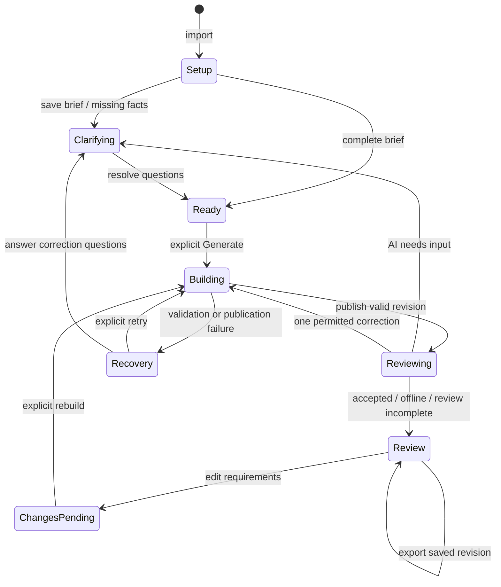

# Application state machines

Audit baseline: `918ddd6` (submitted `main`). Changes are isolated on
`codex/explicit-workflow-state`. This inventory covers Python application/domain
code and the browser components; native library internals are outside its scope.

## Decision

Use small, explicit state models at the existing boundaries. A single giant
state machine would multiply independent viewer, conversation, CAD and export
states and make recovery harder. No new state-machine framework is required.

`fixture/lifecycle.py` is the shared, side-effect-free readiness model. It keeps
**design phase**, **saved CAD freshness**, **question ownership**, **review outcome**
and **pending openings** separate. The workflow strip, project summary,
conversation card and planner context consume this model. Readiness does not
authorize a build; explicit user intent, locks and the compiler still govern it.

| Experience | Result |
| --- | --- |
| UX | Consistent next-step guidance; current review questions survive export/resume; failed publication keeps the previous revision; one active selection tool. |
| DX | Typed phases and modes, one pure readiness function, explicit question ownership, backward-compatible snapshots, tested publication/restore boundaries. |
| AX | Both live planner adapters receive the same JSON readiness, questions, current revision and available next actions. A read-only CLI exposes that state without opening Streamlit. |

## Design lifecycle



Building/reviewing are synchronous operations, not persisted jobs. The pure
`WorkflowState` describes the stable user-facing phase: setup, clarifying, ready,
changes pending, review, or recovery. Existing `Project.stage` strings remain
compatible diagnostic markers. Resuming never replays an interrupted operation.

CAD has an independent state: `absent`, `current`, or `outdated`. An outdated but
valid saved revision remains exportable. A failed new attempt does not make the
old CAD invalid. `can_generate` describes readiness to try; it does not promise
geometry will succeed. `can_export_saved_revision` does not claim STEP is prepared.

Conversation history has a separate presentation projection in
`ui_theme.conversation_sections`: message prefixes group activity versus dialogue,
and the latest user/reply pair is shown above older messages. This grouping is
retained for display only; it does not own questions, grant build permission, or
remove records from the transcript supplied to the planner.

## Inventory

“Explicit” below means the state is now represented directly; “retained” means
the existing protocol was inspected and left in place with its regression tests.

| Machine / owner | States and transitions | Guards and invariants | Treatment |
| --- | --- | --- | --- |
| Import and project identity — `app.load_part`, `Project.load` | Empty → reading → saved project; import failure retains current project; resume selects a saved project. | Analyze and save a new project before publishing it to session state; reject missing active revision IDs. | Publication fixed. |
| Design readiness — `lifecycle.workflow_state` | Setup, clarification, ready, pending changes, review, recovery. | Derived from actual requirements, revision, errors and active questions; no CAD or AI side effects. | Explicit shared model. |
| Brief — `design_brief` | Unstarted → submitted; editing saved brief → saved or rollback. | Blank is unspecified; explicit unknown remains valid; locks apply; saving alone does not build. | Atomic save retained; question ownership reset explicitly. |
| Requirements and CAD freshness — `planning.patch_requirements`, controls | Draft values → validated saved requirements → unbuilt changes → published revision. | Measured evidence, locks and provenance remain authoritative; current CAD uses revision requirements. | Freshness made explicit; individual form transactions retained. |
| Planner — `workflow.plan_design`, `agent.Action` | Request → clarify/propose/build/revise/unsupported; timeout/invalid output/save failure → recovery. | Start only proposes; questions block conversational builds; four-argument adapters remain supported. | Shared state passed to capable adapters; failed persistence rolls back candidate. |
| Question ownership — `QuestionState` | None → planner questions or review questions → superseded/cleared. | Latest explicit owner wins; old transcript questions are not replayed; failed-build review may ask questions without any CAD. | Explicit and persisted; legacy fallback retained. |
| CAD generation/publication — `Project.generate` | Candidate → compile → execute → check → publish snapshot; any failure → retain previous active revision. | File validity alone is not publication; only a successful project save activates a new revision. | Rollback and failure persistence fixed. |
| Native operation graph — `Plan`, `executor` | Bodies created, cut, combined, finished and removed while operations execute in order. | Bounded operations/body counts; references must exist; kernel lock serializes native work. | Retained deterministic validator/executor. |
| AI review/correction — `generate_with_feedback` | Offline, accepted, needs input, repair → second attempt, repair blocked/limit, review error, build-save error. | At most two builds/reviews per invocation; only unlocked concept dimensions may auto-change; storage errors skip dimensional repair. | Retained bounded loop; explicit review-question ownership. |
| Revision graph — `Project.restore` | Active revision → requested historical revision; new build branches from active parent. | Immutable revision artifacts; failed restore save cannot switch the active revision in memory. | Restore transaction fixed. |
| Workspace tool mode — `WorkspaceMode`, `workspace` | Assembly, face, holes, source access, fixture openings. | One project-scoped enum; unknown mode rejected before mutation; old booleans are compatibility mirrors. | Explicit, mutually exclusive. |
| Preview display — `display_controls`, `sync_preview` | Source/fixture visibility, overlays, dimension editing and comparison; deferred post-build view request. | Apply view requests before widgets render; a new revision can return to assembly; display choices do not edit requirements. | Retained; routing uses explicit mode. |
| Mounting selection — `mounting_picker`, `HolePicks` | Face selection → additive ordered hole set → save; new face clears incompatible holes. | Project/selection context and monotonically increasing sequence reject stale updates; repeated clicks do not deselect. | Retained tested protocol. |
| Pointer gesture — `face_picker.js`, `mounting_picker.js`, `opening_picker.js` | Idle → pressed → click or drag/cancel; delayed hover cannot become a later click. | Hit-test visible geometry; rotation/right-click/cancel must not select. | Retained browser tests. |
| Viewer transport/render — mounting and opening components | Unmounted → geometry requested → loaded/acknowledged → updating/drawing → disposed. | Geometry/source keys and request tokens; older acknowledgements cannot overwrite newer local picks; dispose listeners. | Retained browser tests and cache handshake. |
| Source access selection — `access_controls`, `access` | Pick feature → draft intent/padding/reach → saved through/keep-clear requirement → checked cut. | Context/sequence checks; source-frame references rederived each build; selection alone is not a cut. | Retained. |
| Fixture openings — `opening_controls`, `custom_openings` | No location → preview → explicit rebuild → placed; type change → needs placement → repick same ID; remove/resize/reposition. | Exact surface/revision/context; supported flat face, rim/path checks, locks; failed rebuild retains draft and CAD. | Retained; pending count exposed in shared readiness. |
| Dimension editing — `dimensions` | Field/value draft → locked or editable → explicit save/rebuild → success or recovery. | Preview values distinguish saved CAD from current requirements; stale field context rejected. | Retained. |
| Existing-base import — `base_controls`, `existing_base` | Imported reference → selected face/holes/placement → apply/remove. | Base geometry is reference-only; measured pattern and alignment checked during compilation/build. | Retained; independent of source tool mode. |
| Manufacturing/hardware settings — controls, `sheet_controls`, `hardware_controls` | Method/profile drafts → validated settings → pending CAD revision. | Supported profiles, explicit allowances, compatible compiler/body families, no implicit rebuild. | Retained. |
| Native CAD save — `cad_io` | Private staging → export/reopen → verified atomic publish; three local attempts → one isolated fallback → failure. | Unchanged solids across retries; no partial export becomes an accepted revision. | Retained native/file-failure tests. |
| STEP preparation — `step_export` | Not prepared/invalid cache → transfer → reopen/verify → publish STEP/report; failure keeps native CAD. | Revision ID, adapter version and both file hashes checked before offering download. | Retained; separate from conversation readiness. |
| ZIP export — `Project.export` | Saved revision → bundle bytes; optional verified STEP included. | Bundle describes selected revision and its review, not unbuilt requirements; original private STEP excluded. | Removed conversation-stage mutation; legacy argument accepted. |
| Provider invocation — API/subscription adapters | Configured or unavailable → request → typed result / timeout / auth / invalid response. | Opt-in calls, bounded process/request time, no automatic paid API fallback; model output is data. | Retained; optional shared state added without breaking existing call signatures. |
| Persistence/version/cache — `Project.save/load`, compiler versions | v1 legacy snapshot → compatible read; v2 snapshot → explicit error/attempt/question state; immutable analysis/revision serialization caches. | Atomic snapshot replacement; transient state resumes as recovery; historical geometry compiler versions remain unchanged. | v2 metadata added; CAD contracts unchanged. |

## Transition rules worth preserving

- Rendering, inspecting state, switching tools and downloading must never trigger
  planning, geometry generation, repair, or acceptance of assumptions.
- Save and publish are distinct from constructing a valid solid. A failed snapshot
  write rolls back active ID, requirements and revision history in memory.
- Failed restore and failed brief/planner saves retain accepted requirements.
- A build failure and a review failure are different outcomes. Review failure can
  coexist with valid exportable CAD; a failed build must never be reviewed as success.
- Restore clears attempt-specific questions/errors. Export leaves active questions
  alone. New planner/review decisions explicitly own the current questions.
- User intent and available actions are distinct. Agents receive next actions as
  context; the existing user-request, compiler and lock checks remain in force.
- Pick context, event sequence and geometry request tokens solve different stale
  data problems. They must not be replaced with one generic “loading” flag.

## Inspect without changing a project

```powershell
.\.venv\Scripts\python.exe scripts\inspect_state.py artifacts\<project-id>\project.json
```

JSON includes phase, CAD freshness, revision ID, questions and ownership, error,
review outcome, pending openings, next actions, changed requirement field names,
and verified STEP availability. The command reads only: no save, repair, geometry
generation, provider call or session mutation. Provider payloads use the same
readiness schema; third-party planners may accept an optional `workflow_state`
keyword, while existing four-argument planners continue to work.

## Boundaries

This is not an event-sourcing rewrite or background job system. Native crashes are
not automatically replayed. Simultaneous editing of the same saved project from
multiple independent sessions still has no optimistic conflict-resolution protocol.
Individual settings forms retain their existing persistence APIs; this change
does not claim every user-interface mutation has become one global transaction.
No compiler version, geometry operation, hole decision or manufacturing allowance
was changed by this refactor. See `tests/test_lifecycle.py` for transition/failure
tests and the existing UI, viewer, geometry and export suites for preserved behavior.
